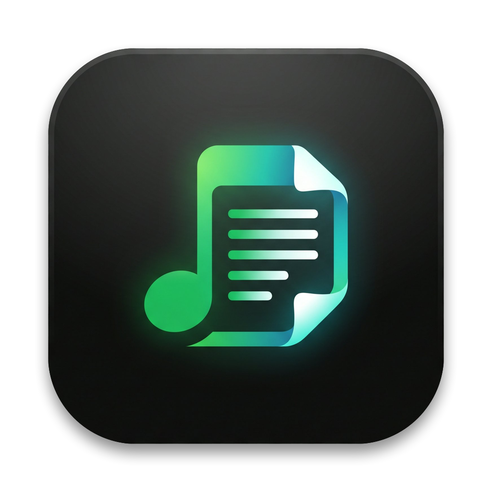

<div align="center">
  
  <h1>TouchLyric</h1>
  <p><strong>Spotify Synchronized Lyrics on your MacBook Pro Touch Bar</strong></p>

  [](https://www.apple.com/macos/)
  [](https://spotify.com)
  [](LICENSE)
</div>

---

**TouchLyric** is a lightweight, native macOS menu bar app that brings synchronized, scrolling Spotify lyrics directly to your MacBook Pro Touch Bar in real-time.

It runs completely in the background, consuming zero CPU when music is paused, and automatically updates whenever you change tracks.

---

## ⚡ Quick Install (One-Liner)

Open **Terminal** (`Terminal.app`) on your Mac and run:

```bash
curl -fsSL https://raw.githubusercontent.com/rizalzaky23/TouchLyric/main/install.sh | bash
```

> **What this does:**
> 1. Downloads the latest pre-compiled `TouchLyric.app` release.
> 2. Automatically moves it to `/Applications`.
> 3. Clears macOS Gatekeeper quarantine flags so it opens without warnings.
> 4. Launches TouchLyric right away!

---

## ✨ Features

| Feature | Description |
|---|---|
| **System-wide Touch Bar** | Shows active, real-time lyrics on your Touch Bar across all apps using native DFR private APIs. |
| **Real-time 250ms Sync** | High-precision tracking synchronized to Spotify's actual playback timeline. |
| **Instant Track Switch** | Automatically detects song changes and loads new lyrics immediately. |
| **Menu Bar Popover** | Click the menu bar icon to view full scrolling lyrics, album art, and track details. |
| **Control Strip Toggle** | Tap the persistent 🎵 icon in the Touch Bar Control Strip anytime to show/hide lyrics. |
| **LRCLIB Caching** | Fetches free synchronized lyrics from LRCLIB and caches them locally for instant reuse. |
| **Lightweight & Efficient** | Native Swift & SwiftUI. 0% CPU consumption when playback is stopped. |

---

## 🚀 Getting Started

1. **Open Spotify** and start playing your favorite song.
2. **Launch TouchLyric** (from `/Applications` or via the one-liner above).
3. When prompted on the first run, click **OK / Allow** for **Automation → Spotify**.
4. Look at your **Touch Bar** — lyrics will now follow along with the music in real-time!

---

## 🛠 Manual Build & Run

If you prefer building from source:

```bash
git clone https://github.com/rizalzaky23/TouchLyric.git
cd TouchLyric
open TouchLyric.xcodeproj
```

- Select the **TouchLyric** scheme.
- Press **⌘R** to build and run.

---

## 📄 License

This project is licensed under the [MIT License](LICENSE).
